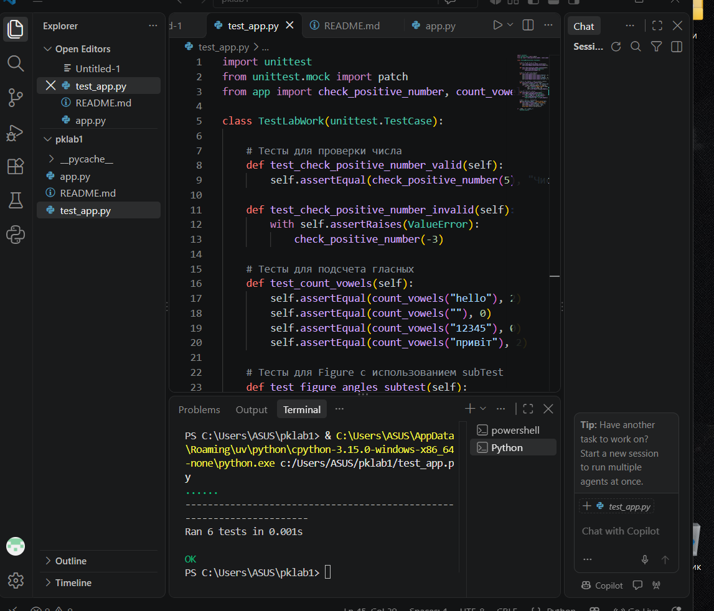

# Звіт до лабораторної роботи

## Тема: Загальне тестування та юніт-тести
## Мета роботи: Ознайомитися з основами тестування та написанням юніт-тестів на Python.

## Виконання роботи:
1. Створено функцію `check_positive_number` для перевірки введеного числа з викликом винятку `ValueError`.
2. Реалізовано функцію `count_vowels` для підрахунку голосних літер. Протестовано звичайний рядок, порожній рядок, рядок із цифрами та рядок із кирилицею.
3. Розширено клас `Figure` методом `get_angles` та додано перевірку граничних випадків (нульова/від'ємна довжина та невідомий тип фігури).
4. Застосовано `subTest` для перевірки кількох типів фігур у межах одного тесту.
5. Використано `@patch` із модуля `unittest.mock` для підміни введення користувача (`input`).

### Результат виконання тестів:

Запуск тестів здійснено за допомогою встроенного інструменту VS Code / запуску файлу `test_app.py`.

## Висновок:
- **Що зроблено:** Написано юніт-тести для функцій та методів класів з використанням модуля `unittest`.
- **Чи досягнуто мети:** Так, мету роботи повністю досягнуто.
- **Отримані знання:** Навчилися тестувати правильні дані та обробку помилок (`assertRaises`), підміняти значення за допомогою `mock.patch` та використовувати `subTest` для оптимізації тестів.
- **Складнощі:** Виникли невеликі складнощі з запуском `python` через консоль Windows, які були вирішені запуском через середовище VS Code.